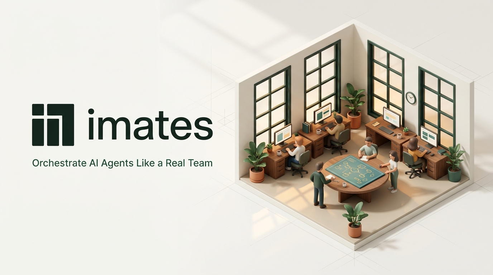
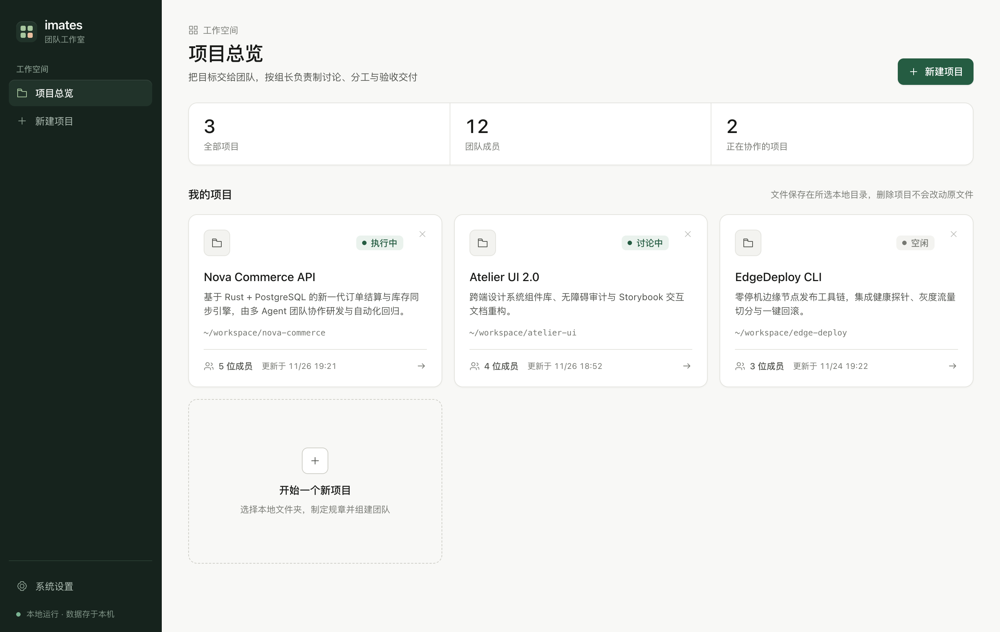
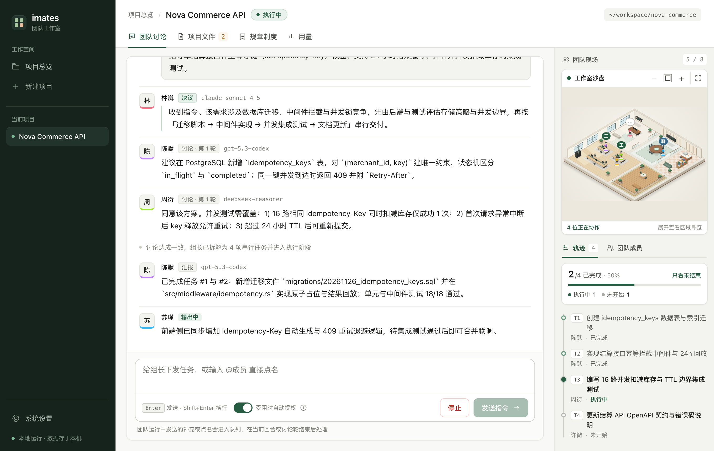
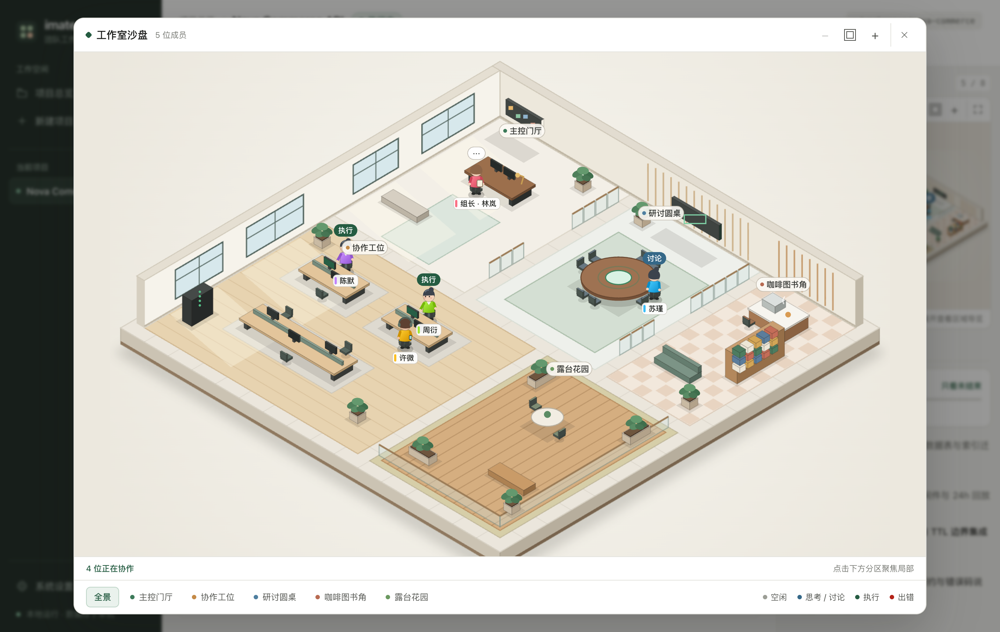
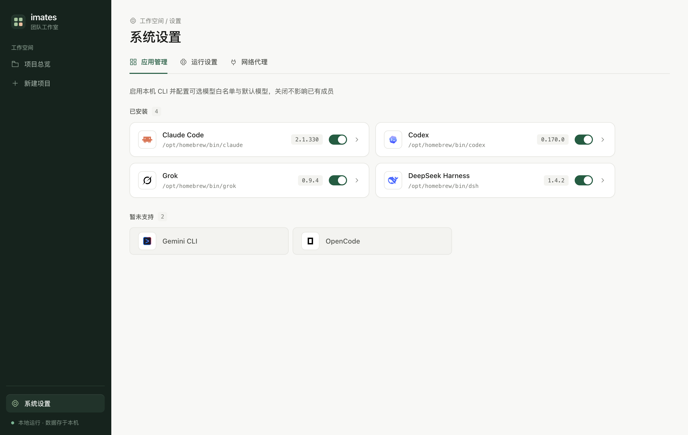
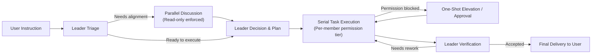

<div align="center"><a name="readme-top"></a>



# imates

**Manage multiple AI coding agents like a real engineering team.**

A local-first Tauri 2 desktop studio.<br/>
Orchestrate your locally installed Claude Code, Codex, Grok, and DeepSeek Harness CLIs into a structured team<br/>
with clear roles, shared engineering rules, and a **Leader-led workflow** from discussion and task delegation to code delivery and verification.

[Features](#-core-features) · [Architecture](#-collaboration--architecture) · [Supported CLIs](#-supported-cli-engines) · [Install](#-installation--quick-start) · [Development](#️-local-development--packaging) · [Docs](#-documentation) · [Issues](https://github.com/coikexxx/imate/issues)

[简体中文](./README.md) · English

<!-- SHIELD GROUP -->

[](https://v2.tauri.app/)
[](https://react.dev/)
[](https://www.rust-lang.org/)
[](#-current-status--delivery-boundaries)
[](./LICENSE)<br/>
[](https://github.com/coikexxx/imate/actions/workflows/ci.yml)
[](https://github.com/coikexxx/imate/releases)
[](https://github.com/coikexxx/imate/stargazers)
[](https://github.com/coikexxx/imate/network/members)
[](https://github.com/coikexxx/imate/issues)
[](https://github.com/coikexxx/imate/commits/main)

</div>

<details>
<summary><kbd>Table of Contents</kbd></summary>

#### TOC

- [👋🏻 Meet imates](#-meet-imates)
- [✨ Core Features](#-core-features)
  - [`01` Build Your Local Agent Studio](#01-build-your-local-agent-studio)
  - [`02` Leader-Led Orchestration: Discuss, Delegate, Execute & Trace](#02-leader-led-orchestration-discuss-delegate-execute--trace)
  - [`03` 2.5D Isometric Studio Diorama](#03-25d-isometric-studio-diorama)
  - [`04` Multi-CLI App Manager, Permission Guardrails & Usage Telemetry](#04-multi-cli-app-manager-permission-guardrails--usage-telemetry)
- [🔄 Collaboration & Architecture](#-collaboration--architecture)
  - [Leader-Led Orchestration Flow](#leader-led-orchestration-flow)
  - [Project Structure](#project-structure)
- [🔌 Supported CLI Engines](#-supported-cli-engines)
- [📦 Installation & Quick Start](#-installation--quick-start)
- [⌨️ Local Development & Packaging](#️-local-development--packaging)
  - [Prerequisites](#prerequisites)
  - [Develop & Test](#develop--test)
  - [Build Desktop Bundles](#build-desktop-bundles)
- [📍 Current Status & Delivery Boundaries](#-current-status--delivery-boundaries)
- [📖 Documentation](#-documentation)
- [📄 License](#-license)

####

<br/>

</details>

<br/>

## 👋🏻 Meet imates

When tackling complex engineering tasks across Claude Code, Codex, Grok, or DeepSeek, you often end up juggling terminal tabs, copy-pasting context, manually splitting work, and checking diffs by hand.

**imates** brings those headless local CLI processes into one calm, structured **desktop team studio**: pick a project directory, set shared engineering rules and member personas, and hand your goal to the team leader. The leader triages the request, runs read-only team discussions, delegates serial implementation tasks, verifies deliverables, and triggers rework when needed—while you stay in control at key checkpoints.

> [!IMPORTANT]
> **Local-first and security-conscious**: All project files, conversation history, task trajectories, and rules stay on your machine (SQLite + your local workspace). imates directly drives your already signed-in CLI toolchains and never reads or stores plaintext API keys or login tokens.

<div align="right">

[![][back-to-top]](#readme-top)

</div>

## ✨ Core Features

<div align="center">

### From isolated terminal tabs to a coordinated AI engineering team

Bring heterogeneous local CLIs into a single workbench where discussion, execution, permissions, and live status remain transparent.

<sub>WHAT MAKES IMATES DIFFERENT</sub>

</div>

<table>
  <tr>
    <td width="50%" valign="top">
      <b>🧭 Leader-Led Orchestration</b><br/>
      A designated leader triages goals, runs read-only parallel discussions to reach alignment, decomposes tasks for serial execution, and verifies deliverables or requests rework.
    </td>
    <td width="50%" valign="top">
      <b>🔌 Multi-CLI Headless Mixing</b><br/>
      Mix and match Claude Code, Codex, Grok, and DeepSeek Harness inside the same project, assigning each member its own model, persona, and reasoning effort.
    </td>
  </tr>
  <tr>
    <td width="50%" valign="top">
      <b>🏛️ 2.5D Isometric Studio Diorama</b><br/>
      An original Canvas 2D miniature studio with five open zones—Leader Desk, Maker Desks, Discussion Table, Coffee Library, and Garden Terrace—driven live by real agent states.
    </td>
    <td width="50%" valign="top">
      <b>🛡️ Guardrails, Permissions & Observability</b><br/>
      Read-only enforcement during discussion, per-member execution permission tiers, one-shot elevation on permission denials, turn/timeout guardrails, file watching, and token/cost summaries.
    </td>
  </tr>
</table>

<br/>

### `01` Build Your Local Agent Studio

Manage multiple local repositories and document folders side by side from the Project Overview. Each project maintains its own team roster, member personas, engineering rules, and run history; removing a project in imates never touches your files on disk.



<div align="right">

[![][back-to-top]](#readme-top)

</div>

### `02` Leader-Led Orchestration: Discuss, Delegate, Execute & Trace

Send a goal in the team workspace and watch the full loop unfold: **Triage → Parallel Discussion → Task Decomposition → Serial Execution → Leader Verification**:

- **Structured team chat**: Messages are clearly tagged as Instruction, Decision, Discussion, Report, or lightweight system timeline notes, with per-turn actual model badges.
- **Seamless mid-run intervention**: Jump in anytime with follow-up notes or `@member` mentions—queued cleanly for the next turn boundary—or stop immediately with full process-tree cleanup.
- **Live trajectory panel**: Tracks task IDs, completion progress, and active/blocked/pending nodes so long multi-turn runs stay legible at a glance.
- **File watcher & shared rules**: Highlights workspace file changes in real time and keeps team engineering rules synced, with a built-in assistant to help draft rules and personas.



<div align="right">

[![][back-to-top]](#readme-top)

</div>

### `03` 2.5D Isometric Studio Diorama

Turn invisible background CLI processes into an at-a-glance studio floor. Expand the diorama into a pan/zoom panorama with zone focus:

- **Five open zones**: **Main Lobby** (leader console), **Collaboration Desks** (staggered maker stations), **Roundtable** (central blueprint illuminates while speaking), **Coffee & Book Corner**, and **Garden Terrace** (idle lounge).
- **Live state mapping**: Thinking, discussing, executing, errored, and idle states drive character pathfinding, speech indicators, and workstation monitors, while respecting `prefers-reduced-motion`.



<div align="right">

[![][back-to-top]](#readme-top)

</div>

### `04` Multi-CLI App Manager, Permission Guardrails & Usage Telemetry

Configure local CLI toolchains, safety guardrails, and proxy routing from System Settings:

- **App Manager**: Auto-detects installed CLIs and versions, supports custom binary paths, per-CLI enable toggles, model allowlists, and default models (disabling a CLI does not break existing members).
- **Fine-grained permissions & one-shot elevation**: Configure execution permission levels per member; when blocked by tool permissions (including Codex and Claude `permission_denied`), allow automatic or manual single-run elevation that reverts immediately after the task.
- **Turn & timeout guardrails**: Configure discussion rounds, rework limits, total turns per instruction (with 3 free protocol-correction retries that do not consume turn budget), multi-stage timeouts, and token/cost telemetry.
- **Unified proxy routing**: System proxy, manual proxy, or direct connection passed consistently to all child CLI processes.



<div align="right">

[![][back-to-top]](#readme-top)

</div>

## 🔄 Collaboration & Architecture

### Leader-Led Orchestration Flow



### Project Structure

```text
imates/
├── src/                        # React 19 + TypeScript + Tailwind CSS v4 frontend
│   ├── pages/                  # Pages: Home / Project / ProjectWizard / Settings
│   ├── components/
│   │   ├── layout/             # Deep pine-green application shell (AppShell)
│   │   ├── project/            # Chat, trajectory, members, file tree, rules, usage & assistant
│   │   ├── settings/           # App manager, CLI details, guardrails, Dsh & proxy settings
│   │   └── ui/                 # Base UI controls, unified Select, icons & CLI logos
│   ├── office/                 # 2.5D isometric diorama renderer, pathfinding & camera
│   ├── stores/                 # Zustand project state store
│   └── lib/                    # Pure utilities (trajectory, usage, run errors, forms)
├── src-tauri/                  # Tauri 2 + Rust 2024 backend
│   └── src/
│       ├── adapters/           # Headless CLI adapters (Claude / Codex / Grok / Dsh)
│       ├── orchestrator/       # Leader-led orchestrator, protocol parser, elevation & guards
│       ├── runner.rs           # Cross-platform process runner, streaming & process-tree cleanup
│       ├── db/                 # SQLite persistence & schema migrations
│       └── watcher.rs          # Real-time project file & rules watcher (notify)
└── docs/                       # MVP spec, CLI probe logs, UI notes & platform verification logs
```

<div align="right">

[![][back-to-top]](#readme-top)

</div>

## 🔌 Supported CLI Engines

imates drives headless CLI tools already installed on your machine—no proxy backend required:

| CLI Engine | Status | Highlights | Notes |
| :--- | :---: | :--- | :--- |
| **Claude Code** (`claude`) | ✅ Supported | Streaming JSON events, session resume, tool-level `permission_denied` detection & one-shot elevation | Supports `plan` / `acceptEdits` / `bypassPermissions` |
| **Codex** (`codex`) | ✅ Supported | Cross-mode resume, reasoning effort, thread cumulative usage, reconnect/waiting-for-network handling | Supports `read-only` / `workspace-write` / `danger-full-access` |
| **Grok** (`grok`) | ✅ Supported | Same-mode resume & cross-mode rebuild, reported model tracking | Integrated with unified proxy & process-tree cleanup |
| **DeepSeek Harness** (`dsh`) | ✅ Supported | Web / Headless auth source switching, multi-provider model catalog & reasoning effort | Credentials stay in Dsh; imates stores no plaintext keys |
| **Pi** (`pi`) | ⏸️ Not enabled | Headless mode probed | Deferred by current scope decision; extensible |

<div align="right">

[![][back-to-top]](#readme-top)

</div>

## 📦 Installation & Quick Start

### 1. Install & sign in to at least one supported CLI

imates does not bundle models or CLI binaries and never stores your API keys. Make sure at least one of the following is installed and authenticated on your machine:

- **Claude Code** (`claude`)
- **Codex** (`codex`)
- **Grok** (`grok`)
- **DeepSeek Harness** (`dsh`)

### 2. Download a prebuilt installer

Download the package for your platform from [GitHub Releases](https://github.com/coikexxx/imate/releases) (or build from source below):

- **macOS (Apple Silicon / Intel)**: Download the `.dmg` and drag `imates.app` into `Applications`.
- **Windows (x64)**: Run the `-setup.exe` NSIS installer.

> [!NOTE]
> **Unsigned beta builds**: Prebuilt packages currently do not include Apple Developer ID notarization or a commercial Windows Authenticode certificate.
> - **macOS**: If Gatekeeper warns that the developer cannot be verified, right-click `imates.app` and choose **Open**, or run `xattr -dr com.apple.quarantine /Applications/imates.app` in Terminal.
> - **Windows**: If Windows SmartScreen appears, click **More info** → **Run anyway**.

### 3. Launch your first team

1. Open **Settings → App Manager** to verify detected local CLIs (and configure proxy settings if needed).
2. Create a new project from **Project Overview**, select your local directory, and assign a Leader and team members.
3. Send an instruction in the workspace to kick off discussion, delegation, execution, and leader verification.

<div align="right">

[![][back-to-top]](#readme-top)

</div>

## ⌨️ Local Development & Packaging

### Prerequisites

- **Node.js** (v20+ recommended) and **npm**
- **Rust toolchain** (supporting Rust 2024 edition) and [Tauri 2 system prerequisites](https://v2.tauri.app/start/prerequisites/)
- At least one supported local CLI (`claude`, `codex`, `grok`, or `dsh`) installed and signed in

### Develop & Test

```bash
# 1. Clone the repository
git clone https://github.com/coikexxx/imate.git
cd imate

# 2. Install frontend dependencies
npm install

# 3. Run desktop app in dev mode
npm run tauri dev
```

Run tests and type checks:

```bash
npm test                                       # Frontend unit tests (Vitest)
npm run build                                  # TypeScript check & production frontend build
cd src-tauri && cargo test -- --test-threads=1 # Backend serial tests (run `npm run build` first if frontendDist is missing)
cd src-tauri && cargo build                    # Backend compile check
```

### Build Desktop Bundles

- **macOS**:
  ```bash
  npm run tauri build -- --bundles dmg
  codesign --verify --deep --strict src-tauri/target/release/bundle/macos/imates.app
  ```
- **Windows**:
  ```bash
  npm run tauri build -- --bundles nsis
  ```
- Bundles are written to `src-tauri/target/release/bundle/`.

<div align="right">

[![][back-to-top]](#readme-top)

</div>

## 📍 Current Status & Delivery Boundaries

- **Core orchestration & adapters (M0–M5)**: Claude, Codex, Grok, and Dsh adapters with unified proxy support; leader triage, parallel read-only discussion, serial task execution, rework, mid-run intervention/`@mention`, 2.5D isometric studio diorama, file watcher, and rules sync are implemented.
- **Permissions, guardrails & observability (M6+)**: Per-member CLI execution permissions, automatic/manual one-shot elevation on denials, independent protocol-correction quota (first 3 retries per instruction do not consume turn budget), turn/timeout guardrails, model badges, and project usage telemetry are implemented.
- **UI language note**: The desktop UI and detailed engineering docs are currently authored in Simplified Chinese; English README and release notes are provided for international developers exploring or building the project.
- **Packaging & signing**: See [Installation & Release Verification (ZH)](./docs/安装与发布验收.md) for build hashes, ad-hoc macOS signing status, and clean-machine verification boundaries.

<div align="right">

[![][back-to-top]](#readme-top)

</div>

## 📖 Documentation

Most in-depth design and verification records are maintained in Simplified Chinese:

| Document | Description |
| :--- | :--- |
| [📘 MVP Development Manual](./docs/MVP开发手册.md) | Authoritative product spec, architecture, collaboration protocol, schema & IPC contracts |
| [🤖 Agent Instructions](./AGENTS.md) | Development conventions, milestone table, and contributor workflow |
| [🧪 CLI Probe Logs](./docs/CLI实测记录.md) | Recorded headless CLI flags, JSON event streams, and permission samples |
| [🎨 UI Polish Log](./docs/界面打磨记录.md) | Studio visual system and 2.5D isometric diorama evolution |
| [✅ Core Flow Checklist](./docs/核心流程验收单.md) | Cross-CLI workflow coverage matrix and smoke verification status |
| [📦 Release Verification](./docs/安装与发布验收.md) | Build provenance, SHA-256 checksums, signing status & verification boundaries |

<div align="right">

[![][back-to-top]](#readme-top)

</div>

## 📄 License

This project is licensed under the [MIT License](./LICENSE).

<div align="right">

[![][back-to-top]](#readme-top)

</div>

---

<div align="center">

Made with ❤️ for multi-agent engineering teams · **[coikexxx/imate](https://github.com/coikexxx/imate)**

</div>

<!-- LINK REFERENCES -->

[back-to-top]: https://img.shields.io/badge/-BACK_TO_TOP-16231d?style=flat-square
