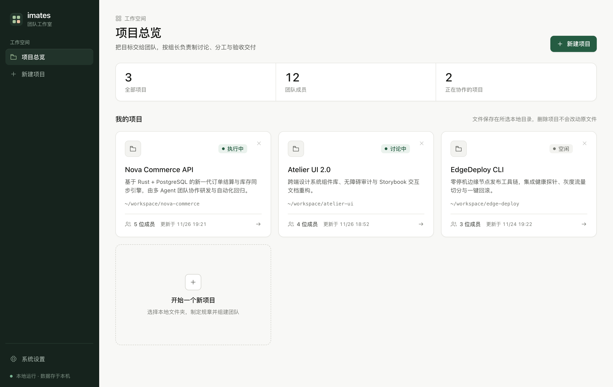
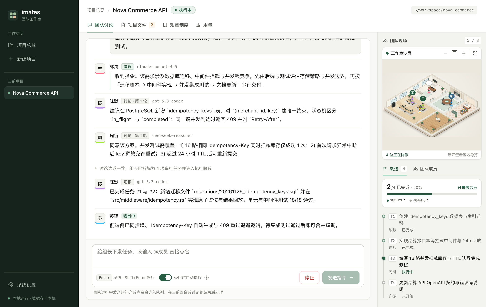
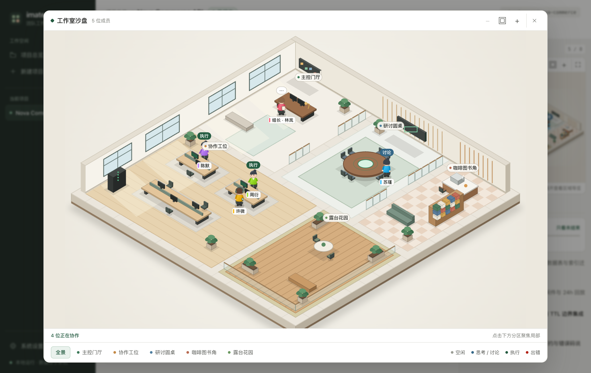
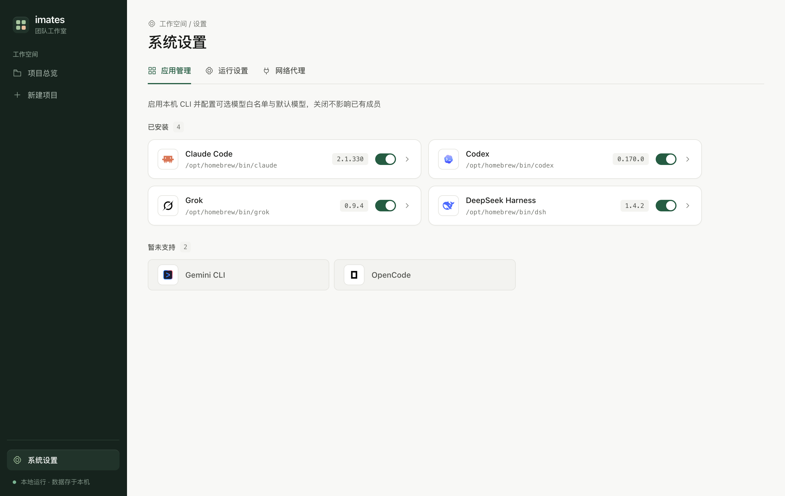
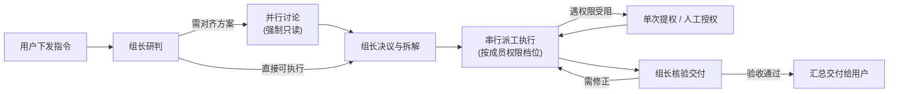

<div align="center"><a name="readme-top"></a>


# imates

**像管理团队一样管理多个 AI Agent**

一款本地优先的 Tauri 2 桌面工作室应用。<br/>
将本机已安装的 Claude Code、Codex、Grok、DeepSeek Harness 编排成一支有分工、有规章的工程团队，<br/>
按「组长负责制」围绕目标讨论方案、拆解任务、执行代码并验收交付。

[核心特性](#-核心特性) · [协作机制](#-协作与架构) · [支持引擎](#-支持的-cli-引擎) · [安装上手](#-安装与快速上手) · [开发打包](#️-本地开发与打包) · [文档索引](#-文档索引) · [反馈问题](https://github.com/coikexxx/imate/issues)

简体中文 · [English](./README.en.md)

<!-- SHIELD GROUP -->

[](https://v2.tauri.app/)
[](https://react.dev/)
[](https://www.rust-lang.org/)
[](#-当前状态与交付边界)
[](./LICENSE)<br/>
[](https://github.com/coikexxx/imate/actions/workflows/ci.yml)
[](https://github.com/coikexxx/imate/releases)
[](https://github.com/coikexxx/imate/stargazers)
[](https://github.com/coikexxx/imate/network/members)
[](https://github.com/coikexxx/imate/issues)
[](https://github.com/coikexxx/imate/commits/main)

</div>

<details>
<summary><kbd>目录导航 (Table of Contents)</kbd></summary>

#### TOC

- [👋🏻 认识 imates](#-认识-imates)
- [✨ 核心特性](#-核心特性)
  - [`01` 组建你的本地 Agent 工作室](#01-组建你的本地-agent-工作室)
  - [`02` 组长负责制：讨论、派工、执行与实时轨迹](#02-组长负责制讨论派工执行与实时轨迹)
  - [`03` 2.5D 等轴测微缩工作室沙盘](#03-25d-等轴测微缩工作室沙盘)
  - [`04` 多引擎应用管理、权限护栏与用量可观测](#04-多引擎应用管理权限护栏与用量可观测)
- [🔄 协作与架构](#-协作与架构)
  - [组长负责制编排流程](#组长负责制编排流程)
  - [项目结构](#项目结构)
- [🔌 支持的 CLI 引擎](#-支持的-cli-引擎)
- [📦 安装与快速上手](#-安装与快速上手)
- [⌨️ 本地开发与打包](#️-本地开发与打包)
  - [前置环境](#前置环境)
  - [开发与验证](#开发与验证)
  - [桌面端打包](#桌面端打包)
- [📍 当前状态与交付边界](#-当前状态与交付边界)
- [📖 文档索引](#-文档索引)
- [📄 开源协议](#-开源协议)

####

<br/>

</details>

<br/>

## 👋🏻 认识 imates

当你同时使用 Claude Code、Codex、Grok 或 DeepSeek 处理复杂工程时，往往需要在多个终端窗口之间来回复制上下文、手工拆活、核对修改。

**imates** 把这些本机 CLI 的无头进程收拢到一个沉着、有秩序的**桌面团队工作室**中：你只需设定项目目录、工程规章和成员分工，将目标交给组长——其余的方案讨论、任务拆解、代码修改、返工修正与结果验收，由整个 Agent 团队在本地自动协作推进，你只在关键节点介入或签收。

> [!IMPORTANT]
> **本地优先，安全克制**：所有项目代码、对话历史、任务轨迹与规章均保存在你的本机（SQLite + 项目目录），直接复用本机已登录的 CLI 工具链，imates 不读取也不保存任何登录令牌或 API Key 明文。

<div align="right">

[![][back-to-top]](#readme-top)

</div>

## ✨ 核心特性

<div align="center">

### 从单兵终端，到一支配合默契的 AI 工程团队

将多个异构 CLI 编排进同一工作台，让讨论、执行、权限与状态全部透明可见。

<sub>WHAT MAKES IMATES DIFFERENT</sub>

</div>

<table>
  <tr>
    <td width="50%" valign="top">
      <b>🧭 组长负责制编排</b><br/>
      组长先研判需求、组织只读并行讨论达成共识，再拆解串行任务派发给各分工成员，并逐项核验交付与触发返工。
    </td>
    <td width="50%" valign="top">
      <b>🔌 多 CLI 无头混编</b><br/>
      同一项目内可自由混搭 Claude Code、Codex、Grok 与 DeepSeek Harness，按角色专长分配不同模型与推理强度。
    </td>
  </tr>
  <tr>
    <td width="50%" valign="top">
      <b>🏛️ 2.5D 微缩工作室沙盘</b><br/>
      内置 Canvas 2D 原创等轴测工作室，主控门厅、协作工位、研讨圆桌、咖啡图书角与露台花园实时映射成员状态。
    </td>
    <td width="50%" valign="top">
      <b>🛡️ 权限、护栏与可观测性</b><br/>
      讨论期强制只读、执行期按成员配置权限档位，支持受阻一次性提权、回合／超时护栏、文件变更监听与用量汇总。
    </td>
  </tr>
</table>

<br/>

### `01` 组建你的本地 Agent 工作室

在「项目总览」中并行管理多个本地代码仓与文档目录，每个项目独立维护自己的团队成员、角色人设（Persona）、项目规章与运行历史；删除项目不会触碰你的原始目录文件。



<div align="right">

[![][back-to-top]](#readme-top)

</div>

### `02` 组长负责制：讨论、派工、执行与实时轨迹

在主工作台下发一条目标指令后，团队将自动经历「研判 → 并行讨论 → 任务拆解 → 串行执行 → 组长验收」闭环：

- **清晰的群聊语义**：消息按「指令」「决议」「讨论」「汇报」与轻量系统时间线区分，并附带每回合真实使用的模型角标。
- **随时介入不断流**：团队运行中可随时插话补充或 `@成员` 直接点名，消息按队列在当前回合结束后平滑接管；支持随时一键停止并清理进程树。
- **右侧轨迹面板**：自动提取任务编号与完成度进度条，实时高亮执行中／受阻／待开始节点，长任务自动聚焦当前进度。
- **文件与规章联动**：实时监听项目目录文件改动并高亮变更文件，支持在「规章制度」标签页维护团队共享的工程规范，并可通过内置助理辅助起草规章与人设。



<div align="right">

[![][back-to-top]](#readme-top)

</div>

### `03` 2.5D 等轴测微缩工作室沙盘

把抽象的后台进程变成一眼可读的团队现场。点击沙盘右上角展开按钮，即可进入支持缩放、拖动与分区聚焦的全景视图：

- **五大开放式功能区**：**主控门厅**（组长胡桃木主控台）、**协作工位**（错落分布的创客协作岛）、**研讨圆桌**（发言时中央蓝图板亮起脉冲）、**咖啡图书角**与**露台花园**（空闲休息区）。
- **实时状态映射**：思考、讨论、执行、出错与空闲五种真实运行状态直接驱动角色动线与气泡提示，执行状态自动点亮对应工位显示器，尊重系统「减少动态效果」偏好。



<div align="right">

[![][back-to-top]](#readme-top)

</div>

### `04` 多引擎应用管理、权限护栏与用量可观测

在「系统设置」中集中管理本机 CLI 工具链、运行护栏与网络环境：

- **应用管理**：自动探测本机已安装 CLI 与版本，支持手动指定路径、独立启停开关、模型白名单与默认模型配置（关闭某 CLI 不影响已有成员）。
- **细粒度权限与一次性提权**：按 CLI 为每位成员设置执行权限档位；遇到权限受阻（覆盖 Codex 与 Claude `permission_denied`）时，支持项目预授权自动单次提权或人工单次授权，任务完成后自动恢复原档位。
- **成本与超时护栏**：统一配置讨论轮数、单任务返工次数、单条指令回合上限（含协议纠错前 3 次独立额度，触顶后提供等待栏深链）与多级超时控制，配合「用量」标签页汇总 Token 与费用证据。
- **统一网络代理**：支持跟随系统代理、手动代理与直连模式，统一透传至各 CLI 进程。



<div align="right">

[![][back-to-top]](#readme-top)

</div>

## 🔄 协作与架构

### 组长负责制编排流程



### 项目结构

```text
imates/
├── src/                        # React 19 + TypeScript + Tailwind CSS v4 前端
│   ├── pages/                  # 页面层：Home / Project / ProjectWizard / Settings
│   ├── components/
│   │   ├── layout/             # 全局深松绿导航壳层（AppShell）
│   │   ├── project/            # 群聊、轨迹、成员、文件树、规章、用量与助理弹窗
│   │   ├── settings/           # 应用管理、CLI 详情、运行护栏、Dsh 与代理设置
│   │   └── ui/                 # 基础控件、统一下拉 Select、线性图标与 CLI Logo
│   ├── office/                 # 2.5D 等轴测工作室沙盘渲染、寻路与镜头控制
│   ├── stores/                 # Zustand 项目状态管理
│   └── lib/                    # 纯函数工具（轨迹、用量、运行错误、护栏表单等）
├── src-tauri/                  # Tauri 2 + Rust 2024 后端
│   └── src/
│       ├── adapters/           # Claude / Codex / Grok / Dsh 无头 CLI 适配器
│       ├── orchestrator/       # 组长负责制编排器、协议解析、提权与回合守卫
│       ├── runner.rs           # 跨平台子进程管理、流式解析与进程树清理
│       ├── db/                 # SQLite 持久化与 Schema 迁移
│       └── watcher.rs          # 项目文件与规章变更实时监听（notify）
└── docs/                       # 产品手册、CLI 实测记录、设计演进与各平台验收记录
```

<div align="right">

[![][back-to-top]](#readme-top)

</div>

## 🔌 支持的 CLI 引擎

imates 直接驱动你本机已安装的无头 CLI 进程，无需额外中转服务：

| CLI 引擎 | 状态 | 典型特性 | 说明 |
| :--- | :---: | :--- | :--- |
| **Claude Code** (`claude`) | ✅ 已接入 | 流式 JSON 事件、会话续接、工具层 `permission_denied` 识别与自动单次提权 | 支持 `plan` / `acceptEdits` / `bypassPermissions` 档位 |
| **Codex** (`codex`) | ✅ 已接入 | 跨模式续接、推理强度、线程累计用量、重连等待网络识别 | 支持 `read-only` / `workspace-write` / `danger-full-access` |
| **Grok** (`grok`) | ✅ 已接入 | 同模式续接与跨模式重建、实际回报模型记录 | 接入统一网络代理与进程树停止清理 |
| **DeepSeek Harness** (`dsh`) | ✅ 已接入 | Web / Headless 认证来源切换、多供应商模型目录与推理强度 | 见下方 Dsh 专项说明 |
| **Pi** (`pi`) | ⏸️ 暂未启用 | 已完成无头模式采样 | 按项目当前决议暂不启用，保留扩展空间 |

> [!NOTE]
> **DeepSeek Harness（Dsh）说明**：进入「系统设置 → 应用管理 → DeepSeek Harness」可配置默认认证与模型配置来源（Web / headless），也可在成员表单中快捷打开。成员指定具体模型时沿用对应供应商在 Dsh 中的凭据与可选推理强度；留空时沿用全局默认认证。imates **不读取也不保存**任何登录令牌或 API Key 明文。

<div align="right">

[![][back-to-top]](#readme-top)

</div>

## 📦 安装与快速上手

### 1. 准备至少一个本地 CLI

imates 不内置 AI 模型或 CLI，也不托管你的 API Key。使用前请在本机安装并完成登录以下任一工具：

- **Claude Code**（`claude`）
- **Codex**（`codex`）
- **Grok**（`grok`）
- **DeepSeek Harness**（`dsh`）

### 2. 下载安装包

前往 [GitHub Releases](https://github.com/coikexxx/imate/releases) 下载对应平台安装包（或按下方说明从源码自行构建）：

- **macOS（Apple Silicon / Intel）**：下载 `.dmg`，挂载后将 `imates.app` 拖入「应用程序」。
- **Windows（x64）**：下载 `-setup.exe` 安装程序按引导完成安装。

> [!NOTE]
> **公测期未签名提示**：当前版本暂未配置 Apple Developer ID 公证与 Windows 商业代码签名证书。
> - **macOS**：首次打开如提示「无法验证开发者」，请右键点击 `imates.app` 选择「打开」，或在终端执行 `xattr -dr com.apple.quarantine /Applications/imates.app`。
> - **Windows**：如遇 SmartScreen 拦截提示，点击「更多信息」→「仍要运行」即可继续安装。

### 3. 三步启动首个团队

1. 打开 imates，进入「系统设置 → 应用管理」确认已探测到本机 CLI（如需代理，在同一页面配置网络代理）。
2. 在「项目总览」点击新建项目，选择本地代码目录并配置组长与执行成员。
3. 进入项目工作台下发一条指令，团队即可自动完成研判、讨论、派工与验收。

<div align="right">

[![][back-to-top]](#readme-top)

</div>

## ⌨️ 本地开发与打包

### 前置环境

- **Node.js**（推荐 v20+）与 **npm**
- **Rust 工具链**（支持 Rust 2024 edition）及 [Tauri 2 系统构建依赖](https://v2.tauri.app/start/prerequisites/)
- 本机安装并登录至少一个受支持的本地 CLI（`claude`、`codex`、`grok` 或 `dsh`）

### 开发与验证

```bash
# 1. 克隆仓库
git clone https://github.com/coikexxx/imate.git
cd imate

# 2. 安装前端依赖
npm install

# 3. 启动桌面应用开发模式
npm run tauri dev
```

运行测试与类型检查：

```bash
npm test                                      # 前端单测（Vitest）
npm run build                                 # 前端 TypeScript 检查与生产构建
cd src-tauri && cargo test -- --test-threads=1 # 后端串行单测（如提示 frontendDist 缺失，先运行 npm run build）
cd src-tauri && cargo build                   # 后端编译检查
```

### 桌面端打包

- **macOS**：
  ```bash
  npm run tauri build -- --bundles dmg
  # 若需同时保留 .app 进行 payload 比对，可使用 --bundles app,dmg
  # 打包完成后请校验签名完整性：
  codesign --verify --deep --strict src-tauri/target/release/bundle/macos/imates.app
  ```
- **Windows**：
  ```bash
  npm run tauri build -- --bundles nsis
  # 首次构建若下载 NSIS 工具超时，直接重试即可复用已下载缓存
  ```
- 安装包产物位于 `src-tauri/target/release/bundle/`。

<div align="right">

[![][back-to-top]](#readme-top)

</div>

## 📍 当前状态与交付边界

- **核心协作与适配（M0–M5）**：Claude、Codex、Grok、Dsh 四套适配器与统一网络代理已落地；组长研判、并行讨论、串行派工、返工、运行中插话／点名干预、2.5D 等轴测微缩工作室沙盘、项目文件监听与规章同步均已完成。
- **权限、护栏与可观测性（M6 及后续修复）**：支持按成员设置 CLI 执行权限、受阻自动／人工单次提权、组长协议纠错独立额度（每条指令前 3 次不占回合）、回合／超时护栏与触顶等待栏深链、模型白名单与角标、项目用量统计。
- **打包与验收说明**：Windows 与 macOS 核心流程实测记录见 [核心流程验收单](./docs/核心流程验收单.md)。修复版 `9301e65` 已产出并校验 macOS arm64 DMG（ad-hoc 签名）与 Windows x64 NSIS（交叉构建）；两平台干净机安装、Windows 原生打包及 Apple Developer ID 签名公证待后续执行，详见 [安装与发布验收](./docs/安装与发布验收.md)。

<div align="right">

[![][back-to-top]](#readme-top)

</div>

## 📖 文档索引

| 文档 | 内容说明 |
| :--- | :--- |
| [📘 MVP 开发手册](./docs/MVP开发手册.md) | 产品定义、架构设计、协作协议、数据模型、前后端接口与里程碑唯一权威依据 |
| [🤖 Agent 执行说明](./AGENTS.md) | 仓库开发规范、文档地图、分支策略与各里程碑进度明细 |
| [🧪 CLI 实测记录](./docs/CLI实测记录.md) | 各 CLI 无头模式调用参数、JSON 事件流与权限行为真实样本 |
| [🎨 界面打磨记录](./docs/界面打磨记录.md) | 团队工作室视觉体系、中性表面重构与 2.5D 微缩工作室沙盘演进记录 |
| [✅ 核心流程验收单](./docs/核心流程验收单.md) | 跨 CLI 环节覆盖矩阵与核心冒烟验证状态 |
| [🍎 macOS 修复验收](./docs/验收记录-2026-11-17-macOS.md) | macOS 原生窗口、Finder PATH、超时、停止与异常恢复实测证据 |
| [🪟 Windows 验收记录](./docs/验收记录-2026-11-19-Windows.md) | Windows 团队返工、进程树收尾与成员执行权限验收记录 |
| [📦 安装与发布验收](./docs/安装与发布验收.md) | 双平台安装包来源、校验哈希、签名状态与干净机验证边界 |
| [💻 多设备开发指南](./docs/多设备开发指南.md) | 在 macOS 与 Windows 之间切换开发的环境配置清单 |

<div align="right">

[![][back-to-top]](#readme-top)

</div>

## 📄 开源协议

本项目采用 [MIT License](./LICENSE) 开源许可协议。

<div align="right">

[![][back-to-top]](#readme-top)

</div>

---

<div align="center">

Made with ❤️ for multi-agent engineering teams · **[coikexxx/imate](https://github.com/coikexxx/imate)**

</div>

<!-- LINK REFERENCES -->

[back-to-top]: https://img.shields.io/badge/-BACK_TO_TOP-16231d?style=flat-square
